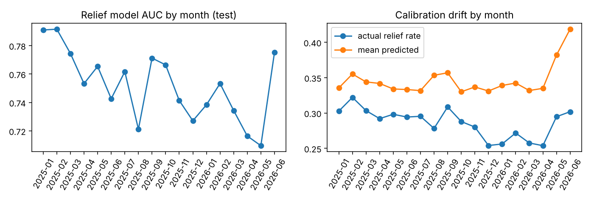

# complaint-intelligence

Complaint intelligence for a credit-card servicing team, built on 193,144 real US credit-card complaints
from the CFPB Consumer Complaint Database. It answers three questions a servicing team asks about each
new complaint:

1. **Which team should own it?** Routing to 10 servicing queues.
2. **Is the customer likely owed something?** Predicting whether the complaint ends in monetary or
   non-monetary relief, so those cases are worked first.
3. **What do we say first?** An LLM triage agent that drafts the first reply and cites the
   rules that apply. It uses the models above, similar past cases and a policy library as tools.

Every model is trained on 2018 to mid-2024 and judged on complaints from 2025 to mid-2026, which it has
never seen. The project also checks how the relief model drifts month by month.

## Results (test period: 55,706 complaints, Jan 2025 to Jun 2026)

### Relief prediction (28.5% of test complaints ended in relief)

| Model | AUC | Avg precision | Relief cases in top 20% of scores |
|---|---:|---:|---:|
| TF-IDF + logistic regression | 0.706 | 0.474 | 35.3% |
| RoBERTa fine-tuned on the narrative | 0.719 | 0.502 | 37.6% |
| LightGBM: text (TF-IDF SVD) + intake fields + company history | 0.753 | 0.534 | 39.9% |
| LightGBM + sentence embeddings | 0.754 | 0.537 | 39.8% |
| Stacked (LightGBM with embeddings + RoBERTa) | **0.755** | **0.539** | **40.0%** |

If the team works the top 20% of complaints by score first, it reaches 40% of all relief cases. That is
twice the rate of working them in arrival order.

What drives it: the narrative carries about half of the LightGBM gain. The rest comes from the
company's relief history before that month, which company it is, and the sub-issue. The fine-tuned
transformer only sees the text, so it trails LightGBM. Embeddings and stacking add almost nothing
(+0.002 AUC). Most of the remaining signal is in the company's own handling, not in how the complaint
is written.

### Queue routing (10 queues; always picking the largest queue scores 28.8%)

| Model | Accuracy | Macro F1 | Right queue in top 2 |
|---|---:|---:|---:|
| Nearest neighbours on sentence embeddings (k = 20) | 57.7% | | |
| TF-IDF + logistic regression | 68.8% | 0.629 | 84.2% |
| RoBERTa, multi-task (queue + relief heads) | 69.0% | 0.607 | 86.3% |
| Ensemble (average of the two above, weight tuned on validation) | **71.1%** | **0.648** | **86.6%** |

Billing disputes route best (F1 0.88). Credit reporting and escalated investigations are the most
confused pair (F1 0.51 and 0.53), because consumers file the same problem under both issues.

### LLM triage agent (Qwen2.5-3B-Instruct, 400 random test complaints)

The agent's tools are the router, the relief model, similar past cases (searched with embeddings) and
12 policy notes on US card rules (Regulation Z billing disputes, FCRA, CARD Act and others; see
`src/complaints/agent/policies.md`). Three designs were compared:

| | No tools | Tools, LLM decides | Guarded |
|---|---:|---:|---:|
| Valid JSON | 100% | 100% | 100% |
| Queue accuracy (router alone: 65.8%) | 38.3% | 56.8% | 57.5% |
| Relief rate: high / medium / low priority | 29% / 22% / – | 30% / 20% / 0% | **40% / 24% / 15%** |
| Share marked high priority | 96% | 87% | 48% |
| Cited policies exist and were provided | 96% | 99.8% | 100% |
| Replies that promise an outcome (rule-based check) | 7.5% | 3.5% | 2.8% |
| Median reply length (words) | 41 | 46 | 54 |

In the guarded design the LLM may only choose among the router's top three queues, and priority comes
from the relief model's thresholds (set on the validation period). The LLM can only raise priority, for
fraud in progress, servicemembers, older consumers or legal action.

What this showed:
- **Tools matter.** Routing accuracy rose from 38% to 57% once the LLM could see the router.
- **The LLM should not make the routing call.** Even when limited to the top three, it overrode the
  router badly and scored 8 points below the router alone. In the final design the classifier owns the
  queue and the LLM owns the reply.
- **Priority needs the model.** Left to the LLM, almost everything was "high". With model thresholds,
  high-priority complaints end in relief 40% of the time and low-priority ones 15%.
- **Promises still slip through in about 3% of replies.** For example, "we will ensure you receive a
  full refund". The rule-based check flags these, so flagged drafts go to a person before sending.
  Replies also run shorter than the 70 to 110 words asked for.

Example outputs are in `docs/results/agent_examples.json`.

### Monitoring



- **Discrimination decays.** Monthly AUC fell from 0.79 in early 2025 to about 0.72–0.74 in 2026.
- **Calibration drifts.** The relief rate fell from 30% to about 25% while mean predicted scores held
  at 0.33–0.35, so the model over-predicts relief.
- **The input that moved most** is company relief history (PSI 0.54 between validation and test).
  Score PSI stayed under 0.03 in most months, which is why monitoring the score alone would miss this.

Recommended response: recalibrate monthly (for example, Platt scaling on the latest closed month) and
alert on input PSI as well as score PSI.

## Data

- **Source.** CFPB Consumer Complaint Database, credit-card products, narratives only.
- **The mirror.** CFPB stopped publishing narratives in August 2026, so the data comes from a public
  Hugging Face mirror taken before that (`Mouwiya/cfpb-consumer-complaints`).
- **Preparation.** `scripts/prepare_cfpb.py`, run in GitHub Actions, writes year/quarter Parquet to
  the `data` branch.
- **Which complaints are kept.** Final outcomes only: closed with explanation, monetary relief, or
  non-monetary relief.
- **Label.** relief = monetary or non-monetary relief.
- **Splits.** Train 2018 to Jun 2024 (121,148), validation Jul to Dec 2024 (16,290), test Jan 2025
  to Jun 2026 (55,706).
- **No leakage.** All features are built in SQL (DuckDB, `src/complaints/sql/base.sql`). Company
  relief history uses only months before the complaint, and the outcome is never a feature. The routing
  label comes from the consumer's chosen issue, so routing models never see the issue field.

## How it runs

- **Code:**
  - `src/complaints/data.py`: SQL pipeline and queue mapping.
  - `models.py`: logistic regression, LightGBM, router and metrics.
  - `monitoring.py`: PSI and monthly reports.
  - `agent/`: policies, tools, prompts, guardrails and scoring.
- **CPU:**
  - `scripts/run_classical.py`: classical models and monitoring.
  - `scripts/run_combined.py`: embeddings in LightGBM, stacking, router ensemble.
- **GPU:**
  - `kaggle/gpu_models.py`: bge-base embeddings with retrieval evaluation, multi-task RoBERTa
    fine-tune.
  - `kaggle/agent_eval.py`: the agent evaluation.
  - Both run on a Kaggle T4 through `.github/workflows/kaggle-run.yml`, which pushes the job to
    Kaggle, waits, and publishes outputs to a `kaggle-out/<job>` branch.
- **Tests:** `pytest`, in CI. They cover labels, splits, the no-leakage company history, PSI, the
  agent's parsing, guardrails and promise check.

```
pip install -e ".[test]"
python scripts/run_classical.py --data data --out docs
python scripts/run_combined.py --data data --gpu out/gpu_models --out docs
pytest -q
```

## Limits

- **Proxy labels.** CFPB outcomes are what companies reported, not an audit of what the customer was
  owed.
- **Queues are a stand-in.** They are a mapping of CFPB issues, not a real issuer's team structure.
- **Small LLM.** The agent is a 3B model chosen to fit one free GPU. A larger model would likely route
  and write better, but the guardrail design does not depend on that.
- **Policy notes are short summaries** for routing and drafting, not legal advice.
